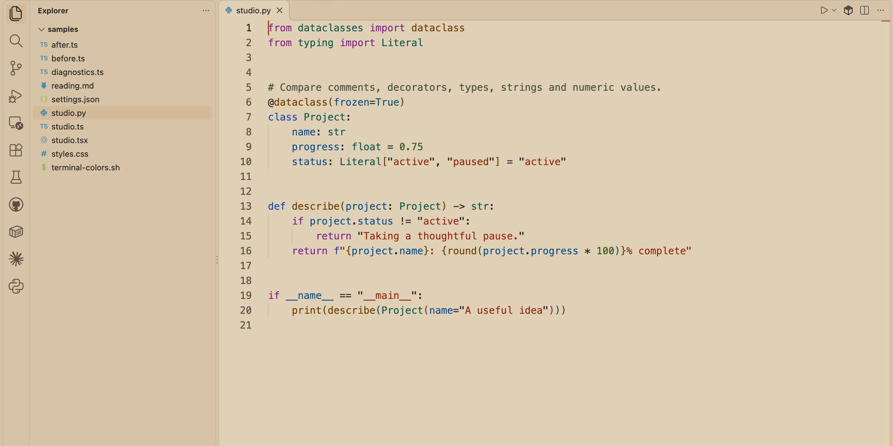
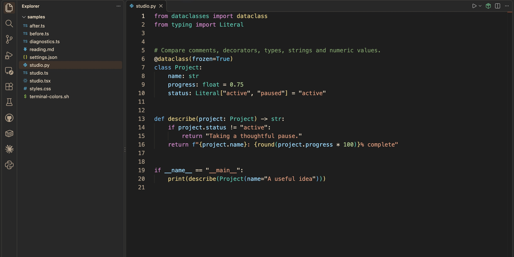

# agape Theme

A warm light theme and a neutral dark theme for Visual Studio Code, by **agape engineering**.

- **agape Light** — Adobe surfaces, charcoal text, and saturated cobalt, teal, violet and burnt-orange syntax.
- **agape Dark** — graphite surfaces, warm text, and distinct blue, teal, gold, purple and terracotta syntax.

Both themes include cinnamon interface accents, semantic and TextMate highlighting, selections, search, diagnostics, Git and diff colors, and a coordinated 16-color terminal palette. The extension is declarative: it has no executable entry point, telemetry, network calls or commands.

## Preview

### agape Light



### agape Dark



Both captures show the same Python sample with Pylance semantic highlighting enabled.

## Install

The project is preparing its first public release. Marketplace and Open VSX listings are not live yet.

To try the current package, build it from source:

```sh
npm ci
npm run package
```

In VS Code, run **Extensions: Install from VSIX…** and choose `dist/agape-theme-0.1.0.vsix`. Then open **Preferences: Color Theme** and select **agape Light** or **agape Dark**.

Theme picker shortcut: **⌘K, ⌘T** on macOS; **Ctrl+K, Ctrl+T** on Windows/Linux.

## Language highlighting

The theme supplies colors; language support identifies what to color. For Python, install **Python** (`ms-python.python`) and **Pylance** (`ms-python.vscode-pylance`) for semantic highlighting of variables, parameters and types. TypeScript and JavaScript language support ships with VS Code. Other languages may need their own language extensions.

If names look different from another VS Code window, compare installed language extensions, the `editor.semanticHighlighting.enabled` setting, workspace trust and custom token overrides. Reload the window after replacing a locally installed VSIX.

## Try without changing your usual profile

The isolated preview helper supports macOS and Linux and requires Node.js 22+, npm, VS Code and its `code` command on your PATH. The theme VSIX itself is platform-independent. On Windows, use a separate VS Code profile or the F5 development host.

```sh
npm ci
npm run preview:light
# or
npm run preview:dark
```

The preview builds, checks and packages the extension, installs it into ignored `.preview/extensions/`, and opens the samples using separate settings in `.preview/user-data/`. It preserves existing preview settings; the `:light` and `:dark` commands explicitly select the requested theme. Your normal settings and extensions are separate. A separate VS Code instance may appear in the Dock.

The preview does not install language extensions automatically. To add Python support to this profile, run from the repository root:

```sh
code --user-data-dir "$PWD/.preview/user-data" --extensions-dir "$PWD/.preview/extensions" --install-extension ms-python.python --install-extension ms-python.vscode-pylance
```

This example uses a POSIX shell. Language extensions are optional and are not bundled with the theme.

Inspect `samples/studio.ts` and `samples/studio.py`. The samples also include TSX, JSON, CSS, Markdown and deliberately invalid TypeScript for diagnostic review. The TSX file is a visual fixture without React dependencies. In the sample terminal, run `sh terminal-colors.sh`; compare `before.ts` and `after.ts` in the diff editor.

Alternatively, open the repository in VS Code and press **F5** to launch the Extension Development Host.

## Development

```sh
npm ci
npm run format:check # verify source formatting
npm run build    # regenerate themes/agape-light.json and themes/agape-dark.json
npm run check    # validate mappings, documented keys and contrast
npm run package  # create VSIX and SHA-256 checksum in dist/
```

Edit `source/palette.json` and `scripts/build.mjs`; keep generated themes synchronized with the source. The palette follows Cinnamon & Adobe identity v1.1.0. The Light and Dark syntax colors are adapted to their backgrounds rather than using identical text colors.

Checks enforce 4.5:1 for the tested syntax, UI text and terminal pairs, including syntax over search and overlapping diff highlights, plus 3:1 for tested focus indicators. This is not a complete accessibility certification or a guarantee of every language grammar's token coverage. Disabled controls and decorative guides are not treated as normal body text.

Version **0.1.0** is the first public preview candidate. Publisher ID `agapeengineering` is provisional until registry ownership is confirmed. The expected extension ID is `agapeengineering.agape-theme`.

## Documentation

- [Contributing](CONTRIBUTING.md)
- [Release and distribution](docs/releasing.md)
- [Screenshot guide](docs/screenshots.md)
- [Brand use](TRADEMARKS.md)

The VSIX uses an explicit file list: only theme JSON, the icon, screenshots and public package documentation are included. Build tools are development dependencies; the installed theme has no runtime dependencies.

Theme code and color definitions are MIT licensed; see `LICENSE`. Brand artwork has separate terms in `TRADEMARKS.md`.
